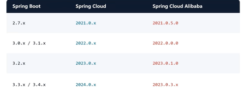
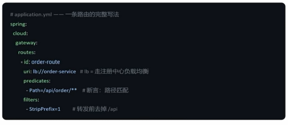
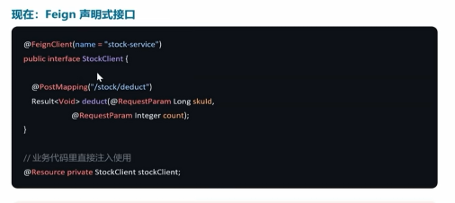
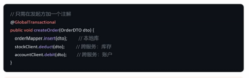
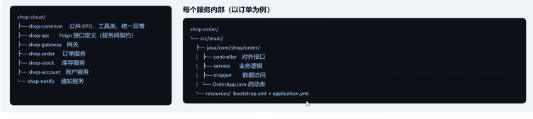
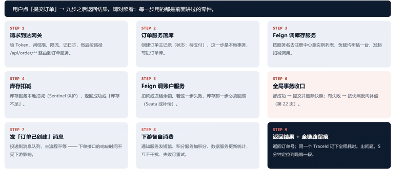
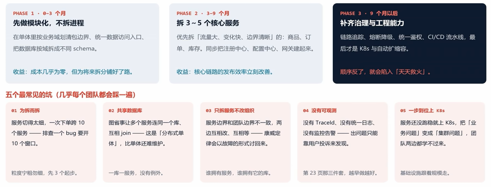

## 单体应用
1. 改一个功能，要改整个应用
2. 一个bug全站陪葬
3. 只能整体扩容，钱花的冤枉
4. 技术栈被绑定死(共享一个运行环境，如果要升级java17要等所有的模块都升级完毕)
5. 公共代码难以维护，容易git冲突
## 微服务架构
把一个大应用拆成一组小服务，每个服务独立开发、独立部署、独立运行，服务之间通过轻量协议(HTTP、TCP)互相调用

### 如何去拆分微服务？
分文件夹,比如com.a，com.b包去拆分代码，解决的是模块化的东西，不是真正的拆分，真正的拆分应该是分进程的，进程隔离，每个服务都是一个独立进程，部署在自己的容器里面，有独立的jvm，独立内存以及独立的连接池。
判断标准就一句话：这个模块，能不能单独重启？能单独重启、单独发版、单独扩容才能叫做微服务
1. 按照业务能力拆分，不按技术维度拆分
2. 高内聚：经常一起改的，放在一起
3. 边界看数据归属：谁拥有数据谁做主：订单表归订单服务，库存表归库存服务，别人想要改库存，只能调用它的接口——不允许直接连它的表

### 微服务带来的问题
1. 调用会失败：网络调用会丢包、超时，对方正在重启，你必须为“对方不回我”设计一套逻辑，需要熔断、重试、降级
2. 对方的地址会发生变化：服务实例随时会扩容、缩容、迁移，IP地址会变化，端口会变，地址一但写死在配置里面，扩容那天就得改代码，需要服务注册与发现
3. 配置满天飞：20个服务，3套环境，改一个数据库地址，要在20个文件中改一遍，然后全部重新发版，需要配置中心
4. 数据不再一家说话：每个服务都有自己的库，比如下单要同时扣除库存与余额需要怎么办？一个@Transactional已经管不了两张表，需要分布式事务，最终一致
5. 出了问题找不到原因：一次下单穿过了6个服务，日志散落在6台机器的6个文件里面，用户说下单失败了，你怎么把这一次调用串起来看，需要链路追踪，日志聚合
6. 入口没人把守：100个服务，难道都对公网暴露？鉴权、限流、日志、跨域、难道每一个服务都需要写一遍？需要网关，统一进行认证

### 微服务之间通信
1. 同步调用：REST/RPC，特点就是实时，结果立刻知道，代码写起来最直观，就像调用本地方法一样，代价就是对方慢，你也慢，对方挂，你就挂，必须要有超时、熔断、降级兜底（下单时，订单服务调用库存服务的接口扣掉库存，等它返回扣成功之后再继续）
2. 异步调用：MQ，特定就是解耦、削峰、不阻塞，代价就是结果就是最终一致，不是立刻一致，链路更难追踪（要配合追踪与幂等），适合发短信，发通知，记日志，更新统计-主线程不需要等待它的事情（下单成功之后，订单服务发一条订单已经创建的消息到队列，然后就返回给用户了）

### 微服务数据库一致性
下单之前要做两件事情，扣库存以及扣余额，它两在同一个数据库中，一个@Transational就能保证要么都成功，要么都回滚，现在库存和余额分属两个服务、两个库——库存扣成功了，扣余额那一步网络超时了怎么办？
1. 策略一：能不用分布式事务就不用
2. 策略二：最终一致，接受中间有几百毫秒不一致，用消息或者补偿把状态推到一致，互联网业务主流做法
3. 策略三：框架来管，用Seata的AT模式，给跨服务操作套一层全局事务，代码改动最小，但是要额外部署组件，有性能开销

> 两条铁律：不允许两个服务同时写一张表，那是分布式事故的温床。跨服务不允许“强一致”的幻想，网络会超时，消息会重复，服务会重启，你的方案里面必须假设这些一定会发生并且能够自愈。

### SpringCloud框架
#### 定义
SpringCloud是一组约定与工具集，用来解决分布式带来的问题，它自己几乎不包含业务逻辑

新项目直接选Spring Cloud Aibaba：Nacos+Sentnel+Seta一套齐活，中文资料最多

#### 服务注册与发现：Nacos
工作流程：启动上报（服务名+IP:端口）——>注册中心：维护实例列表——>心跳续约——>按服务名拉取列表(本地缓存，定期更新)——>择一调用(负载均衡挑实例)

1. 注册的不是代码，而是一份服务名——>可用实例（IP:端口）的名单(注意服务名要全局唯一都稳定，它是服务之间相互认识的唯一凭证，改了名字，所有调用方都得改)，写在application.yml文件中
2. 心跳与下线：默认5s一次心跳，15s标记不健康，30s摘除，服务重启期间调用方可能短暂找不到人，属于正常，需要重试
3. 调用方需要有缓存名单：不可能每次调用都去问注册中心；本地缓存+定时拉取，是性能与实时性的折中

> 注册中心就是分布式系统的通讯录，谁在上班，坐在哪个工位，随时更新

#### 配置中心：Nacos Config
20个服务*3套环境等于60份配置文件，要改一个数据库地址，得改60个地方，重新打20个包，重启20次，而这些配置，原本不该躺在每个项目的代码库中

工作流程：启动时拉取（服务从Nacos读取自己的配置）——>本地生效（和本地配置合并，优先级可调）——>后台改配置(在Nacos控制台改一下)——>推送通知（长轮询，秒级感知变更）——>动态刷新(不重启，配置即可生效)

1. 环境彻底分开，用namespace（开发/测试/生产）+group（业务线）+dataId(服务名)三级定位，生产配置不再误提交到Git
2. 动态刷新：限流阈值、开关、超时时间这类配置，改完立即生效，不用半夜重启服务
3. 可审计，可回滚：Nacos记录了每次变更和操作人，改出问题能一键回滚历史版本，这在出故障时可以救命

> 注意配置文件必须写在bootstrap.yml中，不是application.yml中，写在application.yml中会来不及加载

#### API网关：Spring Cloud Gateway
网关是所有流量的唯一入口，它站在最前面，把每个服务都要做一遍的事情，统一做一次

工作流程：请求进来（带上token和路径）——>断言匹配(按照路径、域名、方法判断去哪)——>过滤器链（鉴权、限流、日志、改写）——>转发到服务(按照服务名负载均衡转发)——>响应返回(再次进过后置过滤器)

网关三大件：
1. 路由：一条路由=一个断言条件+一组过滤器+目标服务
2. 断言：判断这个请求改不改走这条路由：按路径、主机名、请求方法、请求头、时间。
3. 过滤器：路由前后的加工——验token、记日志、限流、给下游加请求头，比如把用户ID传下去、是功能最丰富的地方

> 网关只做与业务无关的通用事情，业务逻辑一律放到服务里

上面这张图中可以看到lib://这个前缀，它表示按照服务名称去注册中心找实例，而不是写死IP，这正是网关和注册中心配合的地方

#### 服务调用：OpenFeign与负载均衡
让一个服务调用另一个服务，写起来就像是调用本地方法，这是微服务日常代码里面出现最多的东西

原始写法：手拼URL，自己序列化，自己解析返回，自己处理异常，一旦服务端接口改了个字段名，客户端要在十处一起改

负载均衡策略：
- 轮询：默认机制，5台实例依此一台一个请求
- 加权/随机：机器配置不同时按权重分流量
- **别忘记超时：默认超时很长，线上必须显式配置**

#### 熔断、降级、限流：Sentinel
工作机制：正常处于关闭状态（正常放行，同时统计错误率和慢调用比例）——>打开状态Open(超过阈值直接拒绝，不再调用)——>半开状态(等待一段时间之后放少量请求试探，成功就恢复，失败则继续打开)，这就是熔断器(保险丝)的工作方式

Sentinel主要管三件事：
1. 流量控制（限流）：按QPS、并发线程数设置上限，超了直接快速失败或者排队等候，保护自己不被刷爆
2. 熔断降级：慢调用比例、异常比例、异常数这三种触发条件，熔断后走fallback兜底逻辑，比如返回稍后重试或者是读取缓存
3. 系统自适应保护：按照CPU、Load自动限流，流量突增的时候先保住系统不崩溃

#### 分布式事务：Seata
前端一个下单请求，后端要跨两个服务、两个库。Seata要做的事情就是给这一次调用套一层全局事务，一个分支失败，全部回滚

工作流程：一阶段：各干各的活，顺手留证据，每个服务执行自己的sql,同时吧改之前的数据写进undo_log快照中，执行完立刻本地提交，不长时间占锁——>二阶段：都成功，协调者通知全局提交，各个服务异步删除掉undo_log快照，事务真正完成——>二阶段如果有失败，按照undo_log里面的快照反向补偿，把数据写回去，实现跨库回滚

- TC：事务协调者：Seata Server，独立部署的一个服务，负责判断全局改提交还是回滚
- TM：事务管理者：发起全局事务的那个服务，用@GlobalTranscational标注，通常是订单服务
- RM：资源管理者：每个参与的分支服务（库存、账户），负责执行自己的sql并上报状态

> TC需要独立部署和维护，如果这个服务挂了，那整个分布式事务也用不了了，同时需要注意分布式事务Seata有全局锁，在高并发场景下可能性能瓶颈，看看能不能通过消息一致性就不用Seata

#### 链路追踪与日志
单体时代：一次报错，一条堆栈就能定位，微服务时代：一次下单穿过网关、订单、库存、账户——日志分散在4台机器的4个文件里面，靠时间戳对不上

工作链路：就是给每一个请求下发一个traceId，通过traceId追踪，一条命令就可以查全链路

> 注意：异步任务要手动传traceId

#### 消息驱动
下单成功之后，要给用户发短信、更新统计、通知仓库。这些事情都不需要用户等待，硬串在同步链路中，只会让下单接口变慢、变脆弱

1. 解耦：加一个下单送优惠券的新需求，只需要新增一个消费者，订单服务一行代码不用改
2. 削峰：大促瞬间10万条下单消息堆在队列中，下游按照能力慢慢消费
3. 最终一致：跨服务的状态同步靠消息推进

> 注意：Spring Cloud Stream是抽象层，国内实际多用RocketMQ(事务消息强)或者Kafka(吞吐高)，重复消息要幂等，同一订单的消息要按照顺序，积压要监控告警，否则用户会发现短信半个小时才到

#### 安全：登录认证在网关只做一次
核心原则：公网只能进网关，业务服务只能在内网互相调用，认证授权在网关收口，下游只管业务

工作流程：登录换令牌——>带令牌请求——>网关验签(验签并解析身份，不查库)——>注入身份头(userId，角色写进请求头)

网关鉴权做的三件事：
1. 验签：确认令牌是自家签发的，没被篡改、没过期。篡改过的令牌一定验不过
2. 注入身份：把userId、角色写进请求头给下游，下游直接取用，不再自己解析令牌
3. 拒绝与限流：无效令牌直接返回401，根本打扰不到下游服务

服务之间互相调用，怎么防？
1. 网络隔离是前提，业务服务只在内网暴露，公网进不来
2. 内部令牌/双向证书：服务之间调用要带专用凭据，防止有人绕过网关直接打内网接口
3. 不信任外部请求头：下游要确认X-User-Id是来自网关，而不是用户自己伪造的
4. 越权要单独查：你是谁网关解决，你能不能看这条数据，业务服务必须再校验一次

### 从零上线一个微服务架构系统
起步阶段用一个仓库、多个模块，改公共代码只提交一次，不用同时开五个仓库

以上每个服务都是独立进程，独立部署，互不影响

怎么部署？
1. 阶段一：一台机器，多个Jar包，java -jar一个个起，写几个启动脚本，但是扩缩容需要手动，挂了要人工启动
2. Docker容器化：每个服务一个镜像，环境一致，但是谁来调度、自愈、扩缩容？容器本身不回答
3. K8s统一调度，把几十个容器交给一个平台管，调度到哪台机器、挂了自动启动、发新版自动滚动、流量大了自动扩容

> 注意：如果团队只有3~5个人，只有几个服务，没有专职运维，没必要上K8s，K8s解决的是规模问题，如果规模没到，它带来的只是复杂度

### 将单体服务拆分成微服务架构（别一次拆完）
